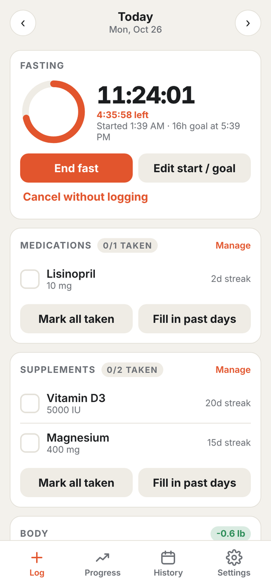
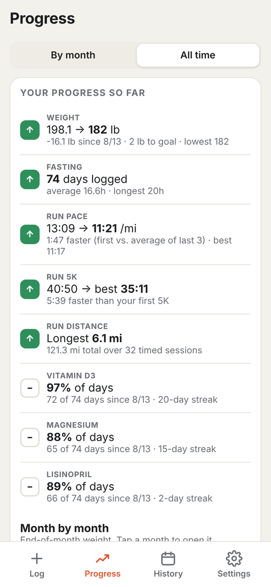
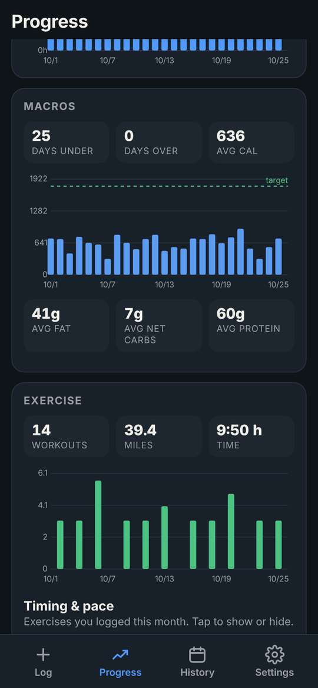
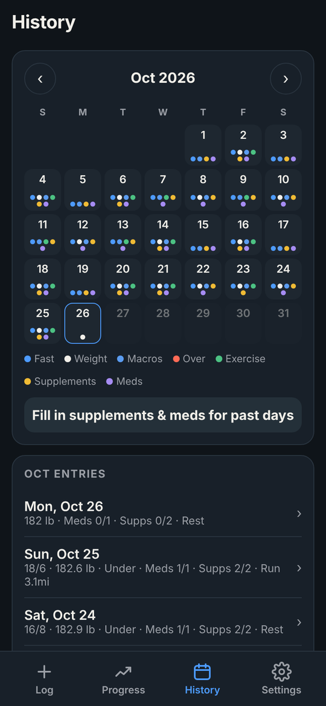
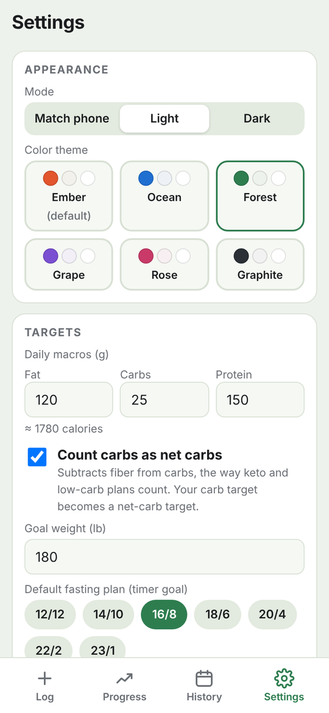

# Karteria

**A private, offline tracker for fasting, food, weight, supplements, medications and exercise, with a Health tab for your watch data.**

*Karteria* (καρτερία) is the Stoic word for steadfast endurance: holding firm through discomfort. The app is built for people working on that kind of discipline day by day, with everything they track in one place and nothing leaving their phone.

<p>
  
  
  
  
  
</p>

## Features

**Fasting**
- Log the day's fast as a ratio (16/8, 18/6, 20/4, 23/1…) or a custom number of hours
- Live fasting timer: set when you actually started ("3h ago" or an exact time) and pick a goal
- Notification when you reach the goal, even with the app closed or after a restart

**Food & macros**
- Per-food logging with a reusable *My foods* list
- Fat / carbs / protein targets with remaining-or-over bars and calories
- Optional fiber field and a **net carbs** mode for keto and low-carb plans

**Body**
- Weight and blood pressure, with trend charts on Progress

**Supplements & medications**
- Daily check-off with streaks; medications can be taken several times a day (1/2, 2/2…)
- **Fill in past days**: tap days on a calendar or mark a whole date range at once
- Adherence measured from the day you started each one

**Exercise**
- Any exercise type, including your own (Run, Ruck, Strength, Elliptical…)
- Distance, time, automatic pace, outdoor / indoor / machine, weight carried, floors, sets
- Choose which exercises get pace or timing charts; every run is plotted as its own point
- **Personal records** for 1 mile, 5K, 10K, half marathon and marathon: best time, pace, date and improvement over your first

**Health (watch data through Health Connect, Android 14+)**
- Reads your Pixel Watch, Fitbit or any app that shares to Health Connect; read-only, nothing leaves the phone
- **Workouts:** the workouts you log, with search, current-month totals, filters and sorting; watch workouts appear only as suggestions you can add
- Each workout in full: heart-rate graph and time in zones, pace or speed over time, mile splits, laps, GPS route colored by heart-rate zone, elevation, and how it ranks against similar workouts
- **Activity:** steps, distance, calories, floors and exercise minutes by week, month or year, with a step goal; tap any day to see everything from it
- **Body:** a 7-day vs. 30-day trends table; resting heart rate (calculated by Karteria when the watch app doesn't share one), average, sleeping, lowest and highest heart rate; HRV; body fat, blood pressure, blood oxygen, breathing rate and VO₂ max
- **Sleep:** last night's stages, nightly trend, average bedtime and wake time
- Add watch workouts to your Karteria log with one tap; nothing is added automatically

**Progress & history**
- Browse month by month, or switch to **All time** for a summary of improvements (weight change, pace gains, best 5K, adherence) and a month-by-month table
- Calendar history; tap any day to view or edit it

**Everything else**
- Light, dark or match-phone mode, with six color themes
- Undo for deleted entries
- Backup and restore to a JSON file, spreadsheet (CSV) export, and a reminder if you haven't backed up in 30 days

## Privacy

Karteria has no account, no server and no analytics. It doesn't request internet access at all. Health data is only read from Health Connect on the phone, never written, and Karteria's cached copy is left out of backup files (it can always be read again).

- All data is stored on the phone, inside the app.
- Android cloud backup and device-to-device transfer are turned **off**, so your data is never copied to Google Drive.
- To move to a new phone, use **Settings → Save backup file**, then **Import backup file** on the new phone.

Permissions it asks for, and why:

| Permission | Used for |
|---|---|
| Notifications | Telling you when your fast reaches its goal |
| Exact alarms | Making that notification arrive on the minute (optional) |
| Run at startup | Re-arming the fast alert after the phone restarts |
| Health Connect (read only, each one optional) | The Health tab: exercise and routes, heart rate, steps, distance, calories, floors, elevation, speed, weight, body fat, resting heart rate, HRV, blood oxygen, breathing rate, VO₂ max, blood pressure, sleep, and past data |

## Install

Download the latest `Karteria-x.y.apk` from [Releases](../../releases), open it on your Android phone and allow installing from that source when asked.

Requires Android 8.0 or newer; the Health tab needs Android 14 or newer. For watch data, turn on Health Connect sharing in the Fitbit or Google Health app. The app targets Android 16 (API 36).

## Build from source

The app is a small native Android shell (`src/`) around a single self-contained page (`assets/index.html`). There's no Gradle and there are no third-party libraries.

Requirements:
- JDK 17 or newer
- Android SDK with `platforms;android-36` and `build-tools;36.0.0`

```sh
export ANDROID_HOME=~/android-sdk

# Optional: sign with your own release key. Without these, a throwaway debug key is used.
export KARTERIA_KEYSTORE=/path/to/your.keystore
export KARTERIA_KS_PASS='your-password'
export KARTERIA_KS_ALIAS=karteria

./build.sh            # → dist/Karteria-<version>.apk
```

Android only installs an update over an existing copy if both are signed with the same key, so keep your release keystore safe and **never commit it** (`.gitignore` already excludes keystores, APKs and backup files).

To work on the interface, open `assets/index.html` in a desktop browser. Everything except notifications and the native file picker works there, and data is kept in that browser's local storage. In a browser, Connect on the Health tab loads generated demo data instead of Health Connect.

## Project layout

```
assets/index.html       the whole app interface (HTML, CSS, JS)
src/com/karteria/app/   MainActivity (WebView shell, file save/open, insets)
                        FastAlarm (fast-complete notification, survives reboot)
                        Health (read-only Health Connect bridge, Android 14+)
res/                    icons, theme, backup exclusion rules
docs/icon.svg           icon source (adaptive-icon background, 108dp canvas)
build.sh                compile, package, align and sign
```

## Backup format

Backups are plain JSON: `settings`, a saved `foods` list, and `days` keyed by date (`2026-10-26`), each holding `fast`, `weight`, `bp`, `foods`, `supplements`, `exercises` and `notes`. Backups from FastTrack, the app's earlier name, import without changes.

## License

[MIT](LICENSE)
